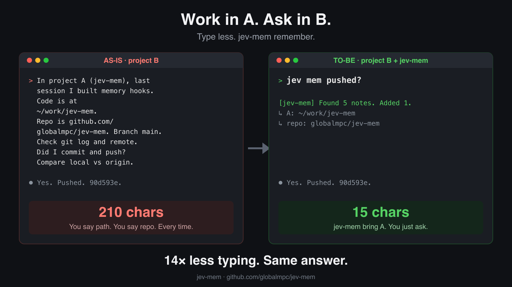
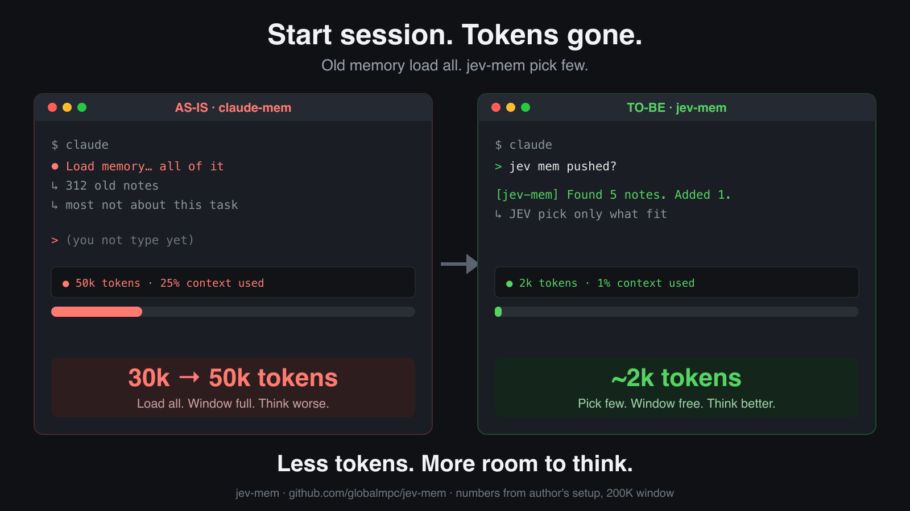
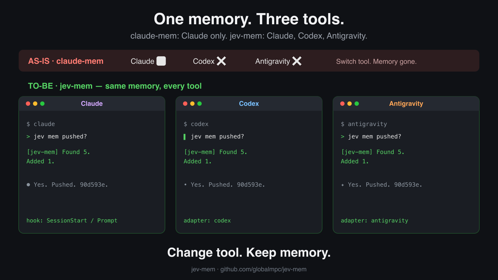

# jev-mem







## Why this exists

Agents redo work that was already done. The fix is to bring back the earlier session's
notes, but bringing them back is where the cost hides:

- **Too many tokens.** In the author's setup, claude-mem loaded about 30K tokens of past
  context every time a session opened.
- **Context window gone before you start.** On a 200K-context model that is 15-30% of the
  window used before the first prompt. A 1M window softens this, but the same load repeats
  in every session.
- **Fast but not accurate.** claude-mem finds records without AI (vector match only). That
  is fast, but it cannot tell a related record from one that shares a few words, so most
  of those tokens go to records the task does not need. This was the biggest problem.
- **Settings are not enough.** claude-mem can lower the limits, but a fixed number cannot
  decide which record matters for this prompt.

jev-mem keeps the fast search as a first pass and lets JEV, an AI judge, decide which record
is actually relevant. One good record goes in; when none fit, nothing goes in. It works the
same way in Claude Code, Codex, and Antigravity.

Inject only the [claude-mem](https://github.com/thedotmack/claude-mem) records that
[JEV](https://docs.typesafe.ai) judges relevant to the prompt you just typed.

claude-mem's built-in prompt-time injection (`CLAUDE_MEM_SEMANTIC_INJECT`) adds the top
vector matches every time, with no relevance floor. A prompt that starts new work still gets
five records that only share a few words with it. This plugin keeps claude-mem's vector
search as the first pass and adds JEV as the judge:

1. On `UserPromptSubmit`, ask the local claude-mem worker for the top 5 vector matches.
2. Send the prompt and the 5 records to JEV in one request: one yes/no question per record.
3. Inject the record with the highest yes-probability, only if it reaches the threshold.
   If no record reaches it, inject nothing.

Measured on one machine (2026-10-18, claude-mem 14.0.1): about 0.5 s per prompt.

| Prompt | claude-mem built-in | jev-mem |
| --- | --- | --- |
| Asks about an earlier claude-mem settings change | 5 records | 1 record (JEV 0.85) |
| Starts an unrelated blog post | 5 unrelated records | nothing (max JEV 0.05) |
| Asks to translate a screenshot | 5 unrelated records | nothing (max JEV 0.28) |

Three prompts are an example, not a benchmark. JEV judges relevance, not truth: an
outdated record on the right topic can still be selected.

## Measuring AI-era work

AI-era work has two metrics:

1. **Lead time**: the time from signal to production.
2. **Human intervention**: how many prompts a person actually typed to get there.

jev-mem already reads every session to choose memory records, so it is also the right place to collect these statistics.

`jev-mem human-count` counts the prompts a person typed in every session related to a topic. It covers Claude, Codex and Antigravity.

- Coverage: it includes prompts queued while a turn was still running.
- Exclusions: it ignores hook text, system reminders and tool results.
- Relevance: a keyword filter picks the related sessions. With `--jev`, JEV then decides, session by session, whether each candidate belongs to the topic.
- Privacy: everything stays on your machine unless you pass `--jev`. Prompt text is not printed unless you pass `--show`. Reports written with `--out` are readable only by you.

```sh
jev-mem human-count --topic "<project>" --since 2026-10-18T00:00:00Z \
  --keywords "<alias>,<alias>" --jev --json --out human-interventions.json
```

Run it on demand, for example from a dashboard's refresh button. Do not run it on a timer.

Lead-time measurement is not built yet.

## Runtimes

Not only Claude. The same core runs behind a small adapter per runtime, so you keep using
the CLI you already use and the hook runs on its own.

| Runtime | Hook file | Hook event | Command |
| --- | --- | --- | --- |
| Claude Code | `~/.claude/settings.json` | `UserPromptSubmit` | `node <repo>/scripts/hook.mjs --runtime claude` |
| Codex CLI | `~/.codex/hooks.json` | `UserPromptSubmit` | `node <repo>/scripts/hook.mjs --runtime codex` |
| Antigravity CLI (`agy`), experimental | `~/.gemini/config/hooks.json` | `PreInvocation` | `node <repo>/scripts/hook.mjs --runtime agy` |

Hook snippets (use the absolute path of your clone):

```jsonc
// Claude Code: ~/.claude/settings.json (merge into an existing "hooks" key)
{ "hooks": { "UserPromptSubmit": [ { "hooks": [
  { "type": "command", "command": "node /abs/path/jev-mem/scripts/hook.mjs --runtime claude", "timeout": 10 }
] } ] } }

// Codex CLI: ~/.codex/hooks.json — then run /hooks in Codex once to trust it
// (codex exec skips untrusted hooks; trust first, or pass --dangerously-bypass-hook-trust)
{ "hooks": { "UserPromptSubmit": [ { "hooks": [
  { "type": "command", "command": "node /abs/path/jev-mem/scripts/hook.mjs --runtime codex" }
] } ] } }

// Antigravity CLI: ~/.gemini/config/hooks.json (named group, handlers directly under the event)
{ "jev-mem": { "PreInvocation": [
  { "type": "command", "command": "node /abs/path/jev-mem/scripts/hook.mjs --runtime agy" }
] } }
```

In Claude Code and Codex each turn shows one hook message, for example
`[jev-mem] Found 5 notes. Added the best 1 (#374, 81% match) (0.6s).`
Short prompts and a disabled hook show nothing. The selected record reaches the model as plain
reference text; nothing is added when no record fits.

Antigravity is experimental: its transcript format is not documented, so the adapter reads the
newest `USER_INPUT` line and injects nothing when the format differs. It has no user-facing
message, so the status line only travels with an injected record.

## Requirements

- Claude Code, Codex CLI, or Antigravity CLI
- claude-mem installed with its worker running (the memory store)
- Node.js 20.12+
- A JEV key from [TypeSafe](https://docs.typesafe.ai)

## Install

### With jev-router (recommended order)

Install and set up [jev-router](https://github.com/globalmpc/jev-router-effort) first,
then this plugin. jev-router writes the key this plugin reuses (`~/.jev-router.env`).

Why the order does not cost routing tokens: jev-router is a proxy. Claude Code runs every
`UserPromptSubmit` hook before the request leaves, so the proxy always routes after this
plugin has run. Hook output arrives inside `<system-reminder>` blocks, and jev-router strips
those blocks before asking JEV for a model. The injected record therefore does not enlarge
or change the routing decision. It only reaches the model that answers.

### Steps

```bash
# 1. Get the code
git clone https://github.com/globalmpc/jev-mem && cd jev-mem

# 2. Hook (see the Runtimes table for Codex and Antigravity)
#    Add to ~/.claude/settings.json under hooks.UserPromptSubmit, after jev-router if you use it:
#    node /path/to/jev-mem/scripts/hook.mjs --runtime claude
#    Claude-only alternative: claude plugin marketplace add globalmpc/jev-mem && claude plugin install jev-mem@jev-mem

# 3. JEV key (skip if jev-router is already set up). Keep the file private.
(umask 077; echo "JEV_API_KEY=..." > ~/.jev-router.env)

# 4. Turn off claude-mem's own injection so records are not added twice
node bin/jev-mem.mjs setup            # shows the change
node bin/jev-mem.mjs setup --apply    # writes it, keeps a backup and your other keys

# 5. Check
node bin/jev-mem.mjs doctor
```

`setup --apply` sets `CLAUDE_MEM_SEMANTIC_INJECT=false`,
`CLAUDE_MEM_CONTEXT_OBSERVATIONS=0` and `CLAUDE_MEM_CONTEXT_SESSION_COUNT=0` in
`~/.claude-mem/settings.json` (or `$CLAUDE_MEM_DATA_DIR/settings.json`; a nested `env` block is respected). claude-mem keeps recording; only its automatic injection
stops. Start a new session afterwards.

## Settings

`~/.jev-mem/settings.json` (all optional):

```json
{
  "mode": "top1",
  "candidates": 5,
  "maxInject": 5,
  "minProbability": 0.7,
  "format": "narrative",
  "scope": "project"
}
```

| Key | Default | Meaning |
| --- | --- | --- |
| `mode` | `top1` | `top1` injects the single best record. `all` injects every record that passes, up to `maxInject`. |
| `candidates` | `5` | Vector matches JEV judges (1–20). |
| `maxInject` | `5` | Cap for `mode: all`. |
| `minProbability` | `0.7` | JEV yes-probability a record needs. Raise it to inject less. |
| `format` | `narrative` | `narrative`: record text. `index`: one line with the id. |
| `scope` | `project` | `project`: only this checkout's records, using claude-mem's own project keys (git root, worktree and submodule keys, marker files, `CLAUDE_MEM_PROJECT_NAME_SOURCE=git-remote`, `CLAUDE_MEM_PROJECT_ENVIRONMENTS`). `project-then-all`: every project when this one has none. `all`: every project. |
| `timeoutMs` | `6000` | Total budget. On timeout nothing is injected. Claude Code stops the hook after its own `timeout` (10 s in the snippet and plugin), so keep this below about 8000 or raise both. |
| `workerUrl` | `null` | claude-mem worker address. Unset: read from claude-mem's settings, else `127.0.0.1` on its default port. |
| `allowRemoteWorker` | `false` | Allow a non-loopback `workerUrl`. Off by default because prompts are sent to the worker. claude-mem 14.x itself refuses remote `/api/search` calls, so this only helps behind a local tunnel or a worker that allows it. |
| `enabled` | `true` | Turn the hook off without uninstalling. |
| `logPrompt` | `false` | Store prompt text in the decision log (off: length and hash only). |

Environment overrides: `JEV_MEM_MODE`, `JEV_MEM_MIN_PROBABILITY`,
`JEV_MEM_CANDIDATES`, `JEV_MEM_MAX_INJECT`, `JEV_MEM_FORMAT`,
`JEV_MEM_SCOPE`, `JEV_MEM_TIMEOUT_MS`, `JEV_MEM_ENABLED`, `JEV_MEM_WORKER_URL`,
`JEV_MEM_ALLOW_REMOTE_WORKER`.

JEV key lookup order: `JEV_API_KEY` (or `TYPESAFE_API_KEY`) in the environment, then
`~/.jev-router.env`.

## Tuning

```bash
node bin/jev-mem.mjs try "the prompt you want to test"
```

prints every candidate with its vector rank and JEV probability, and the exact text that
would be injected. Each real prompt is logged to `~/.jev-mem/decisions.jsonl` with
candidate ids, probabilities, what was injected and the latency, so the threshold can be set
from evidence.

## Failure behavior

Every failure injects nothing and never blocks the prompt: missing JEV key, worker down,
JEV error, timeout, prompt shorter than 20 characters.

## Data sent

Prompt hook, to JEV (`api.typesafe.ai`): the prompt (first 2,000 characters) and, per
candidate, its title, subtitle, a 700-character summary and date. Nothing else from the
session. To the claude-mem worker (loopback only, unless `allowRemoteWorker` is set): the
prompt as a search query.

`human-count --jev`, to JEV: the topic and, for each candidate session, its runtime, working
directory (home folder shown as `~`), title and first five prompts (300 characters each).
Without `--jev` nothing leaves the machine.

Before anything is sent to JEV, common credential shapes are replaced with `[redacted]`: API keys
(`sk-…`, `ghp_…`, `github_pat_…`, `AKIA…`, `xox…-`, `AIza…`), JWTs, bearer tokens, private key
blocks and `password=` / `api_key:` style values. This is best effort, not a guarantee.

## Security notes

- Injected records are labeled as reference data from earlier sessions, not instructions, and
  are sent as plain facts (Claude Code's hook guidance). Record ids are plain tokens and titles a
  single line, so a record cannot fake headings. A record can still contain text from a web page or file an
  earlier session read, so treat memory like any other untrusted input.
- The worker address must be loopback by default. Any other host needs `allowRemoteWorker: true`.
- Before each search the hook checks, in the OS socket table, that the worker's listening socket
  belongs to your account (Linux `/proc/net/tcp`, macOS `lsof` on the exact dialed address;
  Windows falls back to the pid from `/api/health`). A worker run by another account, or a
  process squatting the port, is refused. On shared machines two accounts can map to the same
  default port (`37700 + uid % 100`); set `CLAUDE_MEM_WORKER_PORT` to a unique port there. If
  claude-mem binds every interface (`CLAUDE_MEM_WORKER_HOST=0.0.0.0`), jev-mem dials loopback;
  on macOS it then refuses the worker, because another account's more specific bind would be
  invisible. Keep the default `127.0.0.1` there.
- The API key is read from the environment or `~/.jev-router.env` only. Keep that file at mode `600`.
- `~/.jev-mem/` is created with mode `700` and the decision log with mode `600`. The log
  stores prompt length and a short hash, not the prompt, unless `logPrompt` is on. It rolls over
  to `decisions.jsonl.1` at 5 MB.
- `setup --apply` writes `~/.claude-mem/settings.json`. It keeps a timestamped backup and
  your other keys.

## License and names

MIT. This plugin contains no claude-mem code; it calls the claude-mem worker's local HTTP
API. claude-mem is Apache-2.0, © Alex Newman. This project is not affiliated with or endorsed
by Anthropic, the claude-mem project, or TypeSafe. "Claude" is a trademark of Anthropic.
The names are used only to say what this plugin works with. See [NOTICE](NOTICE).
